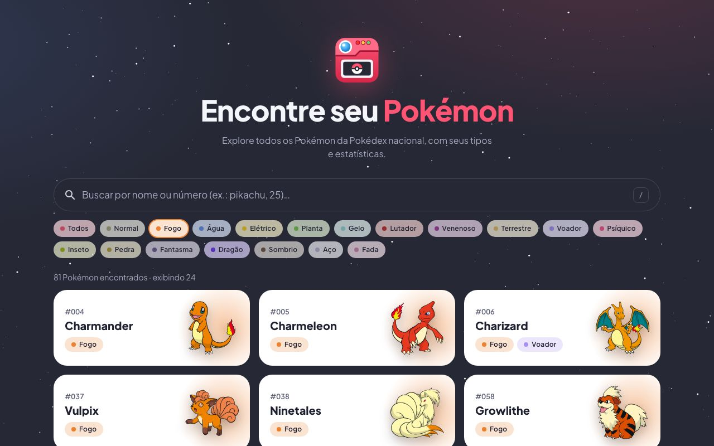
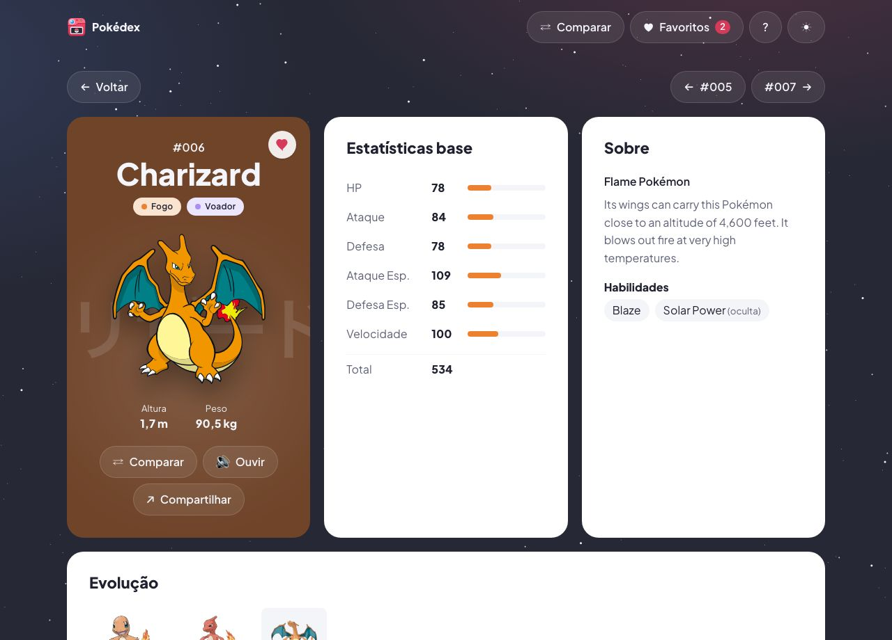

<div align="center">
  

  # Pokédex

  Browse every Pokémon — all 1025 of the National Pokédex — with types, base stats and evolutions.<br>
  Built with Angular and powered by the public [PokéAPI](https://pokeapi.co/). The UI is in Portuguese (pt-BR).

  **[Open the live app →](https://pokedex.mocah.com.br/)** · [GitHub Pages mirror](https://djbrunoramon.github.io/pokedex/)
</div>

<p align="center">
  
  
</p>

## Features

- **Every Pokémon, with infinite scroll** — the full species index loads in one request; cards are rendered 24 at a time as you scroll, and each card fetches its own details (with a placeholder while it loads).
- **Search across the whole Pokédex** — by name (`chu` finds Pikachu, Raichu, Pichu…) or by number (`25`, `#150`), including Pokémon that aren't on screen yet. Press <kbd>/</kbd> to jump to the search box and the × button to clear it; it stays at the top while you scroll.
- **Forgiving search** — a typo with no exact match suggests look-alike names (`pikachuu` → *Você quis dizer:* Pikachu).
- **Filter by type** — the 18 types, in Portuguese, combine with the search; each type on a details page links to the filtered list.
- **Sort** — by number, name, stat total (highest first) or type, combined with the search and the filter.
- **Shareable state** — the search, the type and the order live in the URL (`?q=char&tipo=fire&ordem=total`), so they survive a refresh or a shared link.
- **Coming back where you left off** — *Voltar* returns to the list with the same cards loaded and the same scroll position.
- **Details page** — Pokédex number, types, height and weight, base stats with proportional bars and their total, category, Pokédex description and abilities (hidden one marked), and a clickable evolution chain (branches such as Eevee's side by side). Previous/next buttons, also on the <kbd>←</kbd> <kbd>→</kbd> keys, browse the Pokédex. Play the Pokémon's cry, or share its page (system share sheet, or the link is copied).
- **Favourites** — a heart on every card and detail page; *Meus favoritos* lists them (kept in the browser, synced across tabs).
- **Compare** — up to three Pokémon side by side, their base stats overlaid on a radar chart and in a table (`/comparar?ids=1,4,7`).
- **Light and dark themes** — following the system until you pick one in the header.
- **Installable and offline** — a PWA: the app and the Pokémon you've visited work without a connection.
- **Fast first paint and link previews** — the list and all 1025 detail pages are prerendered at build time, with OpenGraph/Twitter Card tags per Pokémon, a `sitemap.xml` and a `robots.txt`.
- **Loading, empty and error states** everywhere, with a *retry* when the API is unreachable, and a *page not found* for unknown URLs.
- **Polished, accessible UI** — cards and pages coloured by type, an animated starry sky, a skip link, keyboard shortcuts (press <kbd>?</kbd>), focus styles, screen-reader labels and announcements, a back-to-top button, and `prefers-reduced-motion` support. Audited with axe (WCAG 2.2 AA) in both themes.
- **Lean networking** — details, types and evolution chains are cached, requests nobody waits for are cancelled, and the search is debounced.

> The PokéAPI has no Portuguese texts, so the category, description and ability names are shown in English (marked `lang="en"`). Types and stats are translated by the app. See [Known limitations](#known-limitations).

## Tech stack

- [Angular](https://angular.dev/) 22 — standalone components, signals (`computed`, `linkedSignal`, `rxResource`), zoneless change detection
- [RxJS](https://rxjs.dev/) for the HTTP layer
- TypeScript 6 in strict mode, with typed PokéAPI responses
- SCSS with design tokens (CSS custom properties)
- [Vitest](https://vitest.dev/) for unit tests, [Playwright](https://playwright.dev/) for end-to-end tests

## Requirements

- Node.js 20.19+, 22.12+ or 24+
- npm

## Getting started

```bash
npm install
npm start
```

Then open `http://localhost:4200/`. The app reloads automatically when you change a source file (the dev server polls for changes, so this also works on Windows drives mounted in WSL).

## Scripts

| Command                | Description                                                         |
| ---------------------- | ------------------------------------------------------------------- |
| `npm start`            | Start the dev server at `http://localhost:4200/`                    |
| `npm run build`        | Production build to `dist/pokedex/browser/`: prerenders every page, checks them, writes `robots.txt` and `sitemap.xml` |
| `npm run watch`        | Incremental development build                                       |
| `npm test`             | Run the unit tests with Vitest                                      |
| `npm run test:e2e`     | Run the end-to-end tests with Playwright (see [Testing](#testing))  |
| `npm run data`         | Regenerate `src/assets/data/pokemon-summary.json` (stat totals and types, for sorting) |
| `npm run build-github` | Production build into `docs/` for GitHub Pages (see [Deployment](#deployment)) |

## Project structure

```
src/
├── app/
│   ├── models/          # Typed PokéAPI responses
│   ├── service/         # PokeApiService (the only API layer), favourites, theme, SEO tags
│   ├── pages/
│   │   ├── home/        # Hero + Pokémon list
│   │   ├── details/     # Pokémon details, previous/next
│   │   ├── favorites/   # Meus favoritos
│   │   ├── compare/     # Side-by-side comparison
│   │   └── not-found/   # Page for unknown URLs
│   ├── shared/
│   │   ├── poke-list/   # Search, type filter, look-alike names, infinite scroll, states
│   │   ├── poke-card/   # A card that loads its own Pokémon
│   │   ├── poke-search/ # Debounced search box with clear button and "/" shortcut
│   │   ├── poke-about/  # Category, description and abilities
│   │   ├── poke-evolution/ # Evolution chain
│   │   ├── poke-header/ # Top bar: home, compare, favourites, shortcuts, theme
│   │   ├── poke-favorite/, poke-share/, poke-cry/ # Heart, share and cry buttons
│   │   ├── poke-radar/  # Radar chart of base stats
│   │   ├── poke-shortcuts/ # Keyboard shortcuts dialog
│   │   ├── poke-stats/  # Base stats with bars and total
│   │   ├── poke-footer/ # Credits
│   │   ├── directives/  # InViewportDirective (infinite scroll trigger)
│   │   └── pipes/       # DexNumberPipe (#001), SpritePipe (artwork fallback), TypeNamePipe (pt-BR)
│   ├── app.config.ts    # + app.config.server.ts, app.routes.server.ts (prerendering)
│   └── app.routes.ts
├── assets/              # Icons, illustrations, data/pokemon-summary.json
├── config-scss/         # Global SCSS: tokens, reset, type colours, starfield, animations…
└── styles.scss
e2e/                     # Playwright end-to-end tests (*.e2e.ts)
scripts/                 # Post-build checks, robots/sitemap, data and GitHub Pages steps
ngsw-config.json         # Service worker caching (PWA)
vercel.json              # Vercel build, output and fallback
docs/                    # Built site served by GitHub Pages
```

## Testing

### Unit tests

```bash
npm test
```

Specs live next to their subject (`*.spec.ts`) and cover the API service (caching, cancellation, prerender state transfer), the list (paging, search, type filter, sorting, look-alike names, URL sync, restoring the loaded cards, loading states), cards, the details page and its panels, favourites, comparison, theme, SEO tags, shortcuts, the search box, the infinite-scroll directive and the pipes. To run a single file or test:

```bash
npx ng test --include='**/poke-list.component.spec.ts'
npx ng test --filter='searches the whole index'
```

### End-to-end tests

```bash
npx playwright install chromium   # once
npm run test:e2e
```

The suite in `e2e/` drives Chromium through search, the type filter, sorting, the details page, coming back to the list, favourites and comparison, and runs an accessibility audit (axe, WCAG 2.2 AA, both themes) with keyboard checks. It uses the dev server (a running `npm start` is reused, otherwise one is started) and the real PokéAPI, so it needs internet access. Some checks need a production build and are skipped on the dev server: `robots.txt`/`sitemap.xml`, the link-preview tags in the prerendered HTML, and the PWA (manifest, offline). Run them against a build, served locally or deployed:

```bash
npm run build
E2E_BASE_URL=https://pokedex.mocah.com.br npm run test:e2e
```

A failed test keeps a trace in `test-results/`; open the report with `npx playwright show-report`.

## Deployment

The live app, [pokedex.mocah.com.br](https://pokedex.mocah.com.br/), is built and published by Vercel on every push to `main`, as set in `vercel.json`: `npm run build` prerenders the list and the 1025 detail pages into static HTML (Angular SSR in `outputMode: "static"` — no server runs at request time), fails if any page came out without its Pokémon (Vercel then keeps the previous deployment), and writes `robots.txt` and `sitemap.xml`. Other URLs fall back to `index.csr.html`. Set `SITE_URL` to publish under another domain.

A mirror is published to GitHub Pages from the `docs/` folder on `main`; it is client-rendered (no prerendering, no service worker) to keep `docs/` small. To update it:

```bash
npm run build-github   # production build into docs/ with base href /pokedex/
git add docs && git commit -m "chore: deploy to GitHub Pages" && git push
```

The script also copies `index.html` to `404.html`, so deep links such as `/pokedex/details/25` (which GitHub Pages answers with `404.html`) still boot the app, and adds `.nojekyll`.

## Known limitations

- **No Portuguese Pokédex texts (by design, for now).** The PokéAPI has no `pt`/`pt-BR` entries for species descriptions, categories (genera) or ability names — checked on 2026-10-11, its texts come in `de`, `en`, `es`, `es-419`, `fr`, `it`, `ja`, `ja-hrkt`, `ko`, `zh-hans` and `zh-hant`. The app shows them in English rather than machine-translating them; revisit if the PokéAPI adds Portuguese.

## Credits

Pokémon data and artwork come from [PokéAPI](https://pokeapi.co/). Pokémon and Pokémon names are trademarks of Nintendo, Game Freak and The Pokémon Company; this is a non-commercial fan project.

Developed by [Bruno Ramon](https://github.com/djbrunoramon).
